# Distribuidora Valle Express - Rescate Políglota

**Modelado Avanzado de Base de Datos – ESPE** · Docente: Paul Díaz · **Grupo 5:** Mirley Ñacato, David Sangoquiza, Michael Tonato

El Viernes Negro 2025, una sola instancia MySQL con la tabla `ventas_todo` se bloqueó con un `LIKE '%TV%'`, dejó a las cajas sin facturar y terminó cayendo por falta de disco, sin réplica. Este repositorio contiene el laboratorio que reemplaza ese monolito por una arquitectura **políglota, distribuida y con réplica**.

## Arquitectura

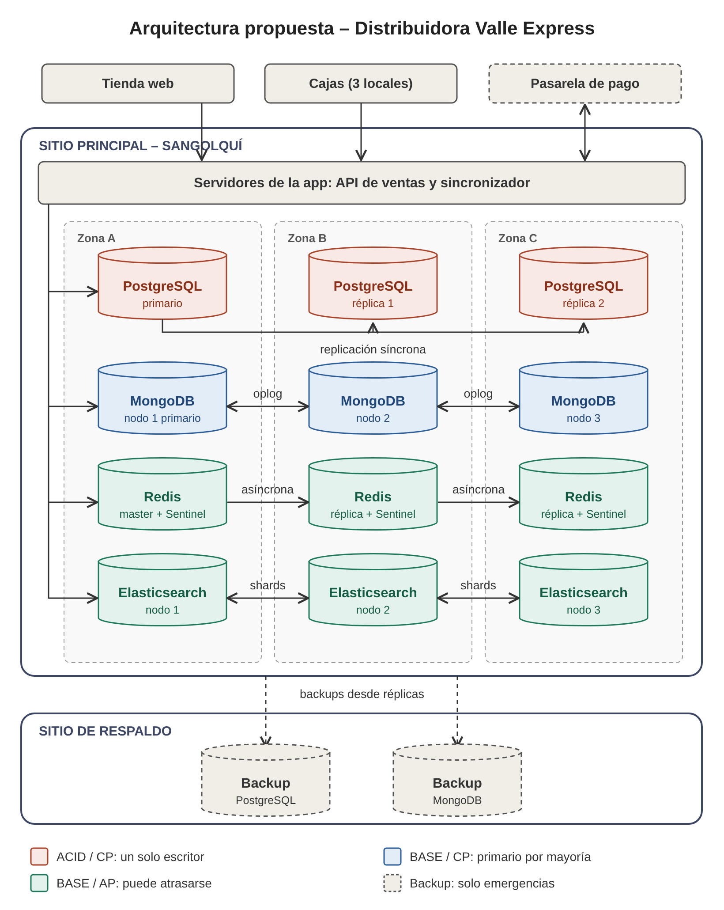

| Dato | Motor | Justificación (ACID/BASE + CAP + PACELC) | Réplica en producción |
|---|---|---|---|
| Facturas, pagos, stock contable | **PostgreSQL** | ACID: un pago no se pierde ni queda a medias. CAP: CP. PACELC: PC/EC. | Streaming síncrono con 2 réplicas (zonas B y C) |
| Catálogo polimórfico, clientes, pedidos | **MongoDB** | BASE: esquema flexible. CAP: CP (primario por mayoría). PACELC: PA/EC. | Replica Set de 3 nodos, `writeConcern: majority` |
| Carrito, sesiones, caché de stock | **Redis** | BASE: dato efímero, prima la latencia. CAP: AP. PACELC: PA/EL. | Master + réplicas asíncronas + 3 Sentinels |
| Búsquedas y reportes | **Elasticsearch** | BASE: índice invertido fuera de la ruta de ventas. CAP: AP. | Shards + 1 réplica por shard |

El laboratorio usa el `docker-compose.yml` entregado por el docente: un nodo por motor (PostgreSQL, MongoDB como Replica Set `rs0` de 1 nodo y Redis con AOF) más sus interfaces web (pgAdmin `:5050`, mongo-express `:8081`, redis-commander `:8082`).

## Estructura

```
docker-compose.yml               Compose entregado por el docente
scripts/00_postgres_esquema.sql  Tablas normalizadas que reemplazan a ventas_todo
scripts/01_postgres_factura.sql  Venta: factura + ítems + pago + stock en una transacción
scripts/02_mongo_venta.js        Catálogo polimórfico + detalle del pedido (w: majority)
scripts/03_redis_carrito.txt     Carrito, caché de stock y última venta
evidencias/                      Capturas 01 a 15 del laboratorio
```

## 1. Levantar la arquitectura

```powershell
docker compose up -d
```

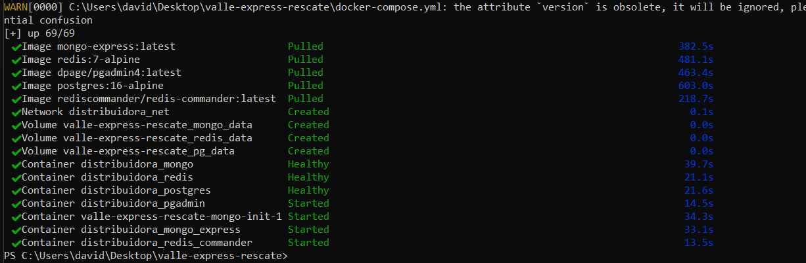

### Replica Set de MongoDB

El inicializador `mongo-init` del compose falla: las comillas dobles de `"rs0"` cierran la cadena de `bash -c "..."` y el script llega a mongosh sin comillas (`SyntaxError`). Se inició el Replica Set manualmente:

```powershell
docker logs valle-express-rescate-mongo-init-1
docker exec distribuidora_mongo mongosh --quiet --eval "rs.initiate({_id:'rs0', members:[{_id:0, host:'distribuidora_mongo:27017'}]})"
docker exec distribuidora_mongo mongosh --quiet --eval "rs.status()"
```

| Error de mongo-init | rs.initiate | rs.status() (captura 1) |
|---|---|---|
| 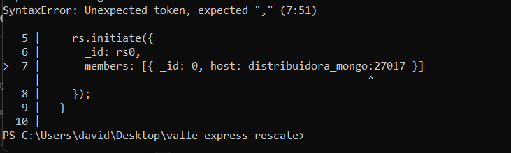 | 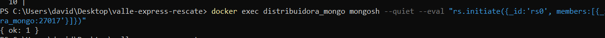 | 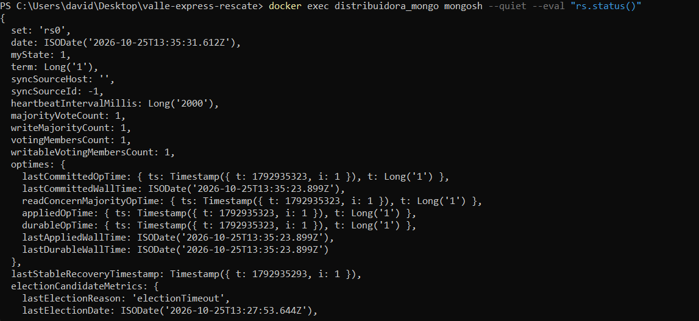 |

## 2. Venta distribuida

La cliente María Pérez compra por la web un televisor ($549,00) y un arroz ($12,25): total $645,44 con IVA. La factura `FAC-2026-0001` enlaza los tres motores.

```powershell
# Esquema transaccional
docker cp scripts\00_postgres_esquema.sql distribuidora_postgres:/tmp/
docker exec distribuidora_postgres psql -U admin -d distribuidora_acid -f /tmp/00_postgres_esquema.sql

# Paso 1: factura en PostgreSQL (ACID)
docker cp scripts\01_postgres_factura.sql distribuidora_postgres:/tmp/
docker exec distribuidora_postgres psql -U admin -d distribuidora_acid -f /tmp/01_postgres_factura.sql

# Paso 2: catálogo y pedido en MongoDB
docker cp scripts\02_mongo_venta.js distribuidora_mongo:/tmp/
docker exec distribuidora_mongo mongosh --quiet /tmp/02_mongo_venta.js

# Paso 3: carrito y caché en Redis
docker cp scripts\03_redis_carrito.txt distribuidora_redis:/tmp/
docker exec distribuidora_redis sh -c "tr -d '\r' < /tmp/03_redis_carrito.txt | redis-cli -a Admin123 --no-auth-warning"
```

| SELECT en PostgreSQL (captura 2) | Pedido en MongoDB | GET en Redis (captura 3) |
|---|---|---|
| 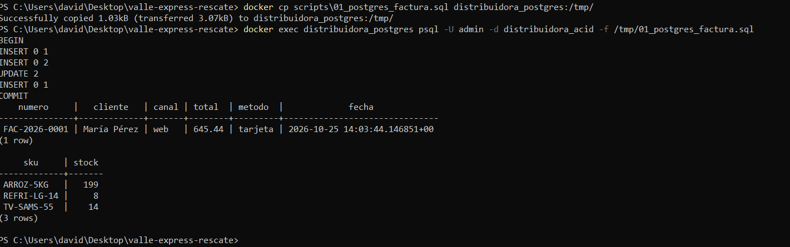 | 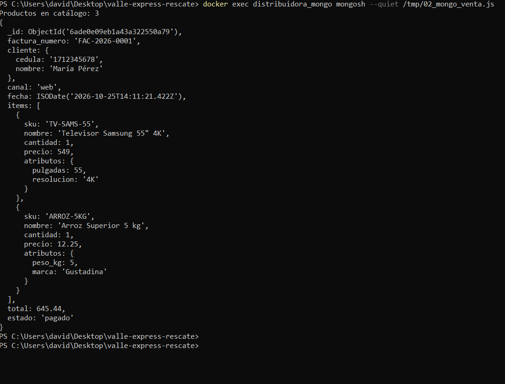 | 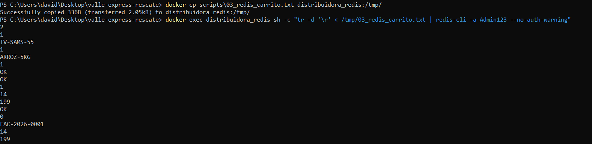 |

## 3. Plan de caos y prueba de supervivencia

| Qué se cayó | Qué siguió funcionando | Qué se perdió | Justificación CAP |
|---|---|---|---|
| **a) PostgreSQL** (`docker stop distribuidora_postgres`) | Catálogo en MongoDB y stock en caché de Redis | No se pudo facturar mientras estuvo caído. Ninguna factura confirmada se perdió | CP (PC/EC): prefiere no responder antes que aceptar datos inconsistentes |
| **b) MongoDB** (`docker stop distribuidora_mongo`) | PostgreSQL siguió facturando (`FAC-2026-0002`) y Redis respondió | Catálogo y pedidos no disponibles. Al reiniciar volvió como PRIMARY sin pérdidas | CP: sin mayoría no hay primario; con 3 nodos, 2 de 3 elegirían uno nuevo |
| **c) Redis** con lag (`docker pause`) y caído (`docker stop`) | El stock se consultó en PostgreSQL y la facturación continuó | Con lag, timeout de 5 s (más latencia). Tras reiniciar, el carrito seguía gracias a AOF | AP (PA/EL): dato efímero; se pierde velocidad, no servicio |

| Escenario | Caída | Recuperación |
|---|---|---|
| A: PostgreSQL | 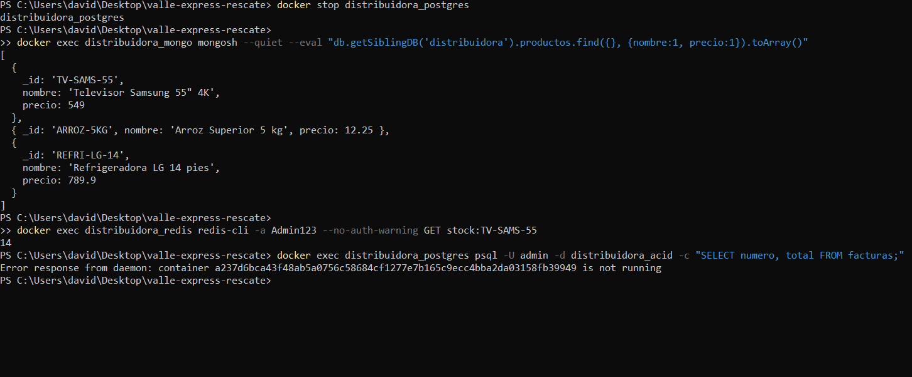 | 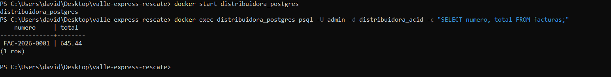 |
| B: MongoDB | 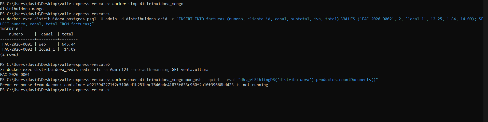 | 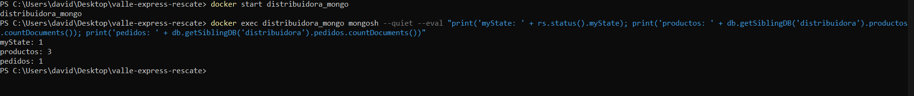 |
| C: Redis | 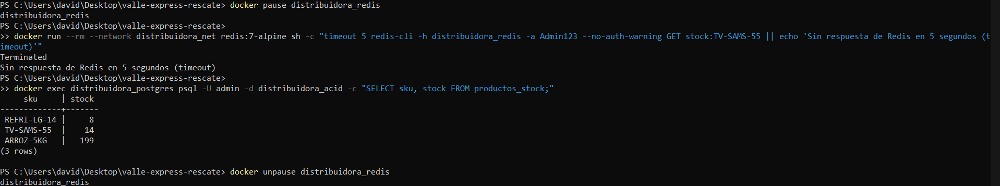 | 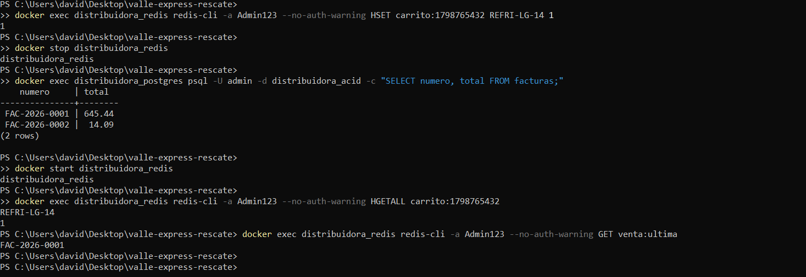 |

## Conclusión

Cada tipo de dato vive en el motor que cumple su necesidad y la caída de uno no detiene a los demás: sin MongoDB se siguió facturando, con Redis caído se siguió vendiendo con más latencia y ninguna escritura confirmada se perdió. La búsqueda `LIKE '%TV%'` ya no compite con las cajas porque el catálogo tiene su propio motor e índice de texto. En producción, las réplicas de la Fase 2 eliminan también la indisponibilidad temporal observada en el laboratorio.
